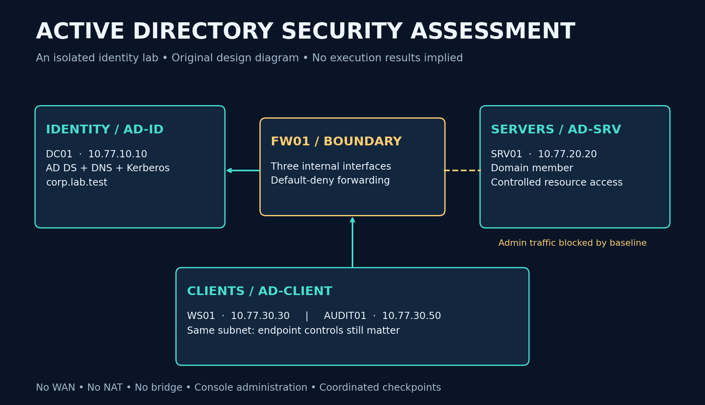
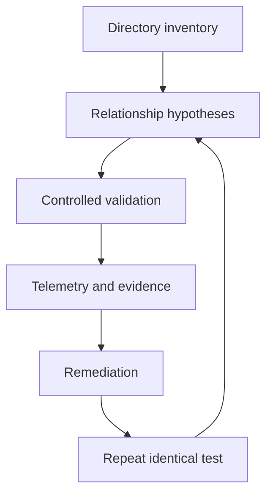

# Active Directory Security Assessment
### Identity attack paths • Segmentation validation • Detection engineering

A reproducible Windows enterprise identity lab for studying how directory permissions, service identities, authentication, and network boundaries interact. It combines PowerShell provisioning, BloodHound investigation, controlled technique runbooks, Windows event analysis, and remediation retesting.

**Status:** implementation and assessment kit. Windows deployment and attack exercises are **not yet executed or verified**. There are no invented screenshots, compromise claims, or performance results. See [validation](docs/VALIDATION.md) and the [execution ledger](templates/execution-ledger.csv).

## What this project demonstrates

| Area | Deliverable |
|---|---|
| Enterprise identity | DC, member server, client, OUs, groups, users and an SPN-bearing service identity |
| Segmentation | Three internal networks and a default-deny routed firewall |
| Attack paths | SharpHound collection, BloodHound graph review, PowerView cross-checks |
| Adversary techniques | Kerberoasting, bounded password-spray validation, Pass-the-Hash, privilege relationships and Golden Ticket assessment plans |
| Blue team | Audit policy, evidence collection, event correlation and false-positive analysis |
| Reporting | ATT&CK mappings, NIST control alignment, finding template and retest workflow |

## Start here

1. Follow [LAB-SETUP](docs/LAB-SETUP.md) on a virtualization-capable Windows/Linux host. **Google Colab cannot host this Windows AD lab.**
2. Build the baseline with the numbered [PowerShell scripts](scripts/).
3. Take a coordinated checkpoint of all VMs, then follow [ASSESSMENT](docs/ASSESSMENT.md).
4. Capture evidence with [DETECTION](docs/DETECTION.md), remediate, and repeat the same test.
5. Use the [INTERVIEW-GUIDE](docs/INTERVIEW-GUIDE.md) to explain the design and limitations accurately.

## Architecture

| VM | Address | RAM / CPU | Role |
|---|---|---|---|
| DC01 | 10.77.10.10/24 | 4 GB / 2 | Windows Server 2022, AD DS + DNS |
| SRV01 | 10.77.20.20/24 | 4 GB / 2 | Windows Server 2022 member |
| WS01 | 10.77.30.30/24 | 4–6 GB / 2 | Windows 11 Pro/Enterprise client |
| AUDIT01 | 10.77.30.50/24 | 4 GB / 2 | Linux assessment workstation |
| FW01 | .1 in each subnet | 1 GB / 1 | Debian router, nftables |

Domain: `corp.lab.test`; NetBIOS: `CORPLAB`. Three VirtualBox **Internal Network** switches: `AD-ID`, `AD-SRV`, `AD-CLIENT`. No WAN, bridge, NAT, shared folders or clipboard during exercises. Allow 32 GB host RAM and roughly 200 GB free disk. Windows 11 requires compatible VM TPM/Secure Boot settings; use legitimate installation media and licenses/evaluation terms.

## Repository guide

- `scripts/`: provisioning, auditing, health checks and evidence export.
- `config/`: topology and router firewall policy.
- `docs/`: setup, assessment, detections, mappings, interview notes and sources.
- `templates/`: finding and execution records; all activities initially NOT RUN.
- `assets/`: original diagrams plus editable generation source.
- `tests/`: static integrity checks; these do not substitute for Windows execution.

## Verify the repository

From the repository root, run `python3 tests/validate_static.py` to check the topology, local links and evidence templates. See the [validation boundary](docs/VALIDATION.md) for the Windows and network checks that require the lab. Use the [execution ledger](templates/execution-ledger.csv) to track each deployment and retest.

## Evidence standard

A graph edge is a hypothesis until its prerequisites are validated. An open port is not proof of lateral movement. A requested service ticket is not proof of a recovered password. Successful authentication is not proof of privileged authorization. Each finding needs source, destination, account context, UTC timestamps, raw artifact hash, observed result and a matched retest.

Keep raw tickets, hashes, credentials, EVTX and BloodHound exports outside Git. Commit only reviewed, redacted reports. [Security and scope](SECURITY.md) • [References](docs/REFERENCES.md)
