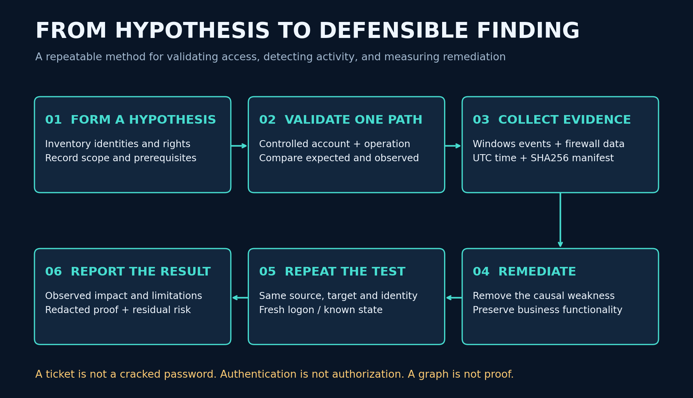

# Detection and evidence



Enable auditing before the test, verify it after Group Policy refresh, and export promptly. Event availability depends on OS version, effective audit settings and object SACLs. The supplied policy enables process creation but does not enable command-line capture; configure that separately if needed and assess secret exposure.

| Behavior | Useful sources | Interpretation limits |
|---|---|---|
| Service-ticket requests | DC Security 4769 | Volume, requester, service and encryption are context; legitimate service access creates the same event |
| Authentication failures | DC 4771 / 4776; target 4625 | Protocol affects which events appear; correlate accounts, source and time |
| Lockout | DC 4740 | Validate caller fields and prior failures; do not intentionally lock real accounts |
| Network logon | Target 4624, type 3; 4672 | Type 3 is common; 4672 is not proof of exploitation |
| Group membership changes | 4728/4729 global, 4732/4733 local/domain-local, 4756/4757 universal | Collect on the system that owns the group; correlate intended changes |
| Directory modifications | 5136 | Requires appropriate Directory Service Changes auditing and SACL |
| Processes and scripts | 4688; PowerShell Operational 4104 | Coverage depends on policy and execution route; logs may contain secrets |
| Service installation | System 7045; Security 4697 if enabled | Not expected from read-only assessment; investigate unexpected activity |
| Network boundary | FW01 nftables counters and kernel logs | Rate limiting drops log messages; counters and destination listener help attribution |

## Local triage example

Run on DC01 after the experiment; adjust the time window to the recorded ledger. This is a review query, not a validated production detection rule.

```powershell
$start=(Get-Date).AddMinutes(-20)
Get-WinEvent -FilterHashtable @{LogName='Security';Id=4769,4771,4776,4740;StartTime=$start} |
  Select-Object TimeCreated,Id,MachineName,Message |
  Export-Csv C:\Windows\Temp\lab-review.csv -NoTypeInformation
```

Use `07-CollectEvidence.ps1 -OutputDirectory C:\LabEvidence` on each Windows VM. On FW01 capture `nft -a list ruleset` and `journalctl -k` for the same UTC window. Preserve timezone offset, collector host, account, start/end times, hashes and tool versions. Full EVTX exports contain unrelated lab activity; use time-scoped analysis and retain originals privately.

## Detection hypotheses to evaluate

1. **Spray:** unusually many distinct failed identities from one source in a short window. Begin with a small lab threshold (two identities), then compare with typo and stale-service-password controls. This threshold is not production-ready.
2. **Kerberoasting:** unusual service-ticket volume or service-account targets from an unexpected principal. Compare normal service usage and scheduled jobs. Encryption type is one signal, not a verdict.
3. **Unexpected administration:** network logon to SRV01 from the client segment combined with privilege/share access and a policy exception. A logon event without authorized action is weaker evidence.
4. **Ticket abuse:** ticket/logon inconsistencies plus correlated resource activity. Time skew and incomplete collection can explain apparent anomalies.

For each hypothesis record true/false positive examples, missed telemetry, sample size and blind spots. Do not calculate precision or recall without labeled trials and explicit denominators. No SIEM integration or trained ML detector is claimed by this repository.
